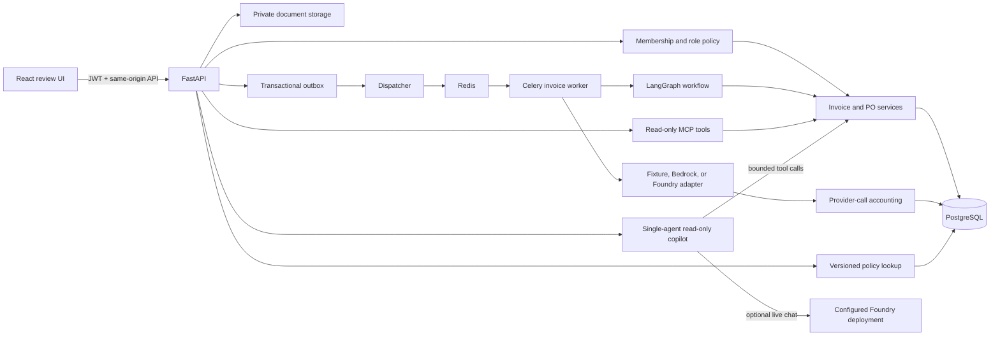
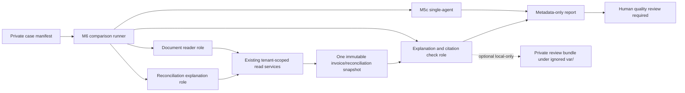

# System architecture

## Product path

## M6 experiment boundary

The M6 runner is a local evaluation utility. It adds no product API, background job, write tool, or approval path. Both arms use the same signed-in principal and invoice route ID. The runner checks that the immutable version and reconciliation snapshot remain unchanged between reads and model calls. It blocks fixture rows before any provider invocation and never writes questions, model answers, tool results, or document content into the report. A separate private review bundle is written under ignored `var/` only when explicitly requested for human scoring.

## Boundaries and invariants

- The signed membership principal supplies the organization for every REST, MCP, copilot, and experiment read. A request body or document cannot select a tenant.
- Invoice versions and reconciliation snapshots are immutable. Copilot and M6 reads are pinned to one version and stop if the snapshot changes.
- Reconciliation status and issue codes come from deterministic application rules. The model may explain them, but cannot recalculate or change them.
- Review decisions, approval records, and payment operations remain outside all model and MCP tools. Only reviewer-authorized domain services can record approval.
- Uploaded files, extracted values, evidence quotes, policy passages, prompts, prior assistant notes, and tool output are untrusted data. They never authorize a tool or decision.
- Money is represented as `Decimal` in domain services and stored in PostgreSQL numeric columns.
- Fixture mode is a no-key plumbing demo. The visible UI badge remains, and fixture rows are excluded from model accuracy and M6 experiments.
- The M6 experiment uses the same pinned Foundry deployment/configuration and per-arm deadline/output limit for both arms. Quality remains `NOT_MEASURED` until human review; a mechanically valid source ID does not prove that a citation supports a claim.

## Deployment boundary

The default Docker Compose stack is verified for local development and demo use. A separate production Compose target builds a static frontend and TLS ingress against external managed PostgreSQL/Redis and private S3 storage. It has been config-checked and image-built locally, but not deployed. Managed secrets, provider identity, domain/DNS, backups, monitoring, and an operator-provisioned organization still require an explicitly provisioned environment.
